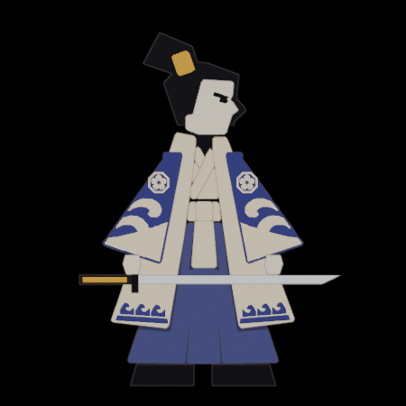
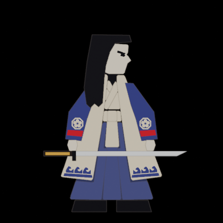
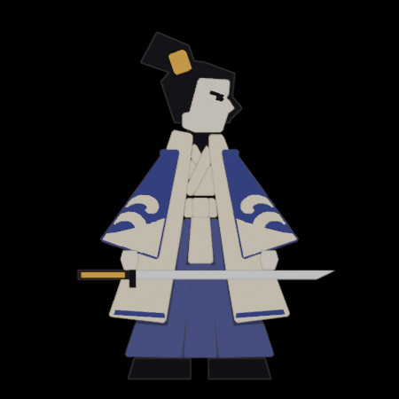
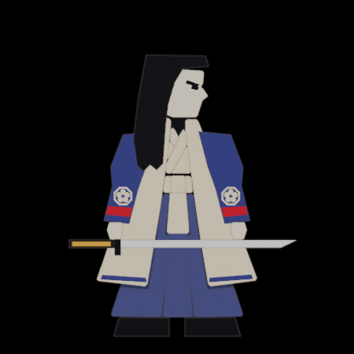
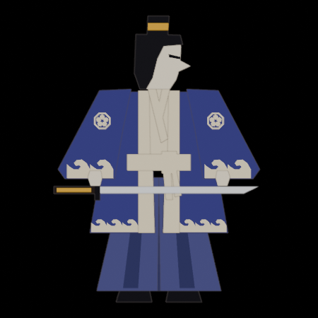
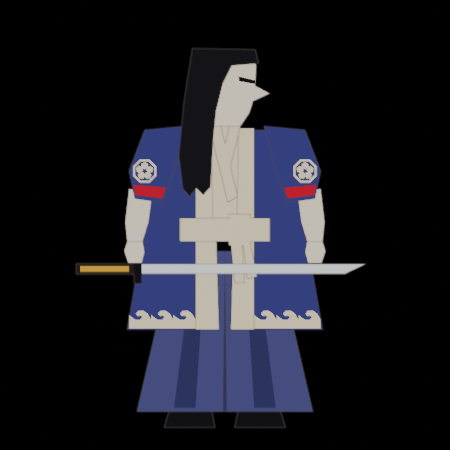
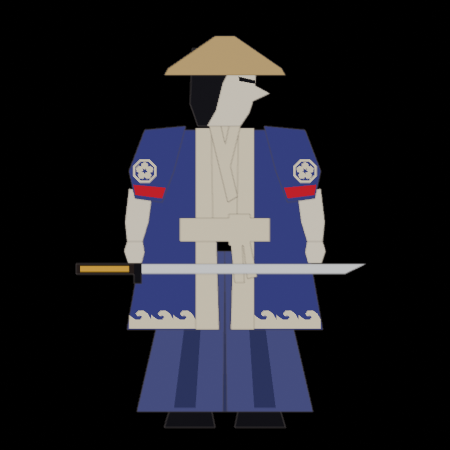

# Fighter model versions

Every version of the fighter model (`public/models/samurai.glb`, made from `art/fighters/samurai.blend`) that has shipped to the live game, newest first. Kami and Sumi share one model; Sumi's colours are swapped in the game, so the pictures show both in Kami's colours.

Each version is kept in `art/fighters/versions/`: the game file (`samurai-vN.glb`), its Blender file (`samurai-vN.blend`) and front pictures. **To bring an old version back**, ask Claude to "restore fighter model vN": it copies those two files over the current ones and opens a PR.

**Rule for every PR that changes the model:** add a row here, and save the new version's `.glb`, `.blend` and pictures in `art/fighters/versions/` (the number goes up by one).

| Version | Shipped | PR / live build | What changed |
|---|---|---|---|
| **v5** (current) | (on merge) | [#81](https://github.com/MarcialPimentel/papercut/pull/81) | Sumi's sleeves get a sloped shoulder like Kami's (the flat top looked boxy). The outfits cover the whole body again: Waves adds a row of waves above the coat hem and puts the crest back on Kami's sleeves; Stripes runs down the coat in the set's main colour. |
| v4 | 2026-11-04 | [#79](https://github.com/MarcialPimentel/papercut/pull/79), build 1acdcce | Both fighters traced from Marz's clean front-view drawing (`art/fighters/reference/kami_front.webp`): a stacked paper kimono with tilted topknot, tall collar, big hanging sleeves with cream wave cuffs, long cream coat, three-part obi, apron, three hakama strips. Shoulders lower and narrower; arms the same length, so poses and reach are unchanged. Sumi's sleeves reach the wrist, with her crest and cord at the wrist. |
| v3 | 2026-11-03 | [#67](https://github.com/MarcialPimentel/papercut/pull/67), build 11bff80 | Sumi wears her long hair down instead of the straw hat. |
| v2 | 2026-11-02 | [#46](https://github.com/MarcialPimentel/papercut/pull/46), build 6d1d1b0 | Kami and Sumi get their own pieces: Kami's topknot and wide sleeves, Sumi's straw hat and tied-back sleeves with bare forearms. |
| v1 | 2026-11-02 | [#26](https://github.com/MarcialPimentel/papercut/pull/26), build 0d768ef | The first papercraft samurai from the Blender model guide: one look for both fighters, built by hand in Blender. |

## Pictures

| | Kami | Sumi |
|---|---|---|
| **v5** |  |  |
| **v4** |  |  |
| **v3** |  |  |
| **v2** |  |  |
| **v1** |  | (same model as Kami) |

The pictures are flat Blender renders; the game adds the ink lines and the cream rim.
